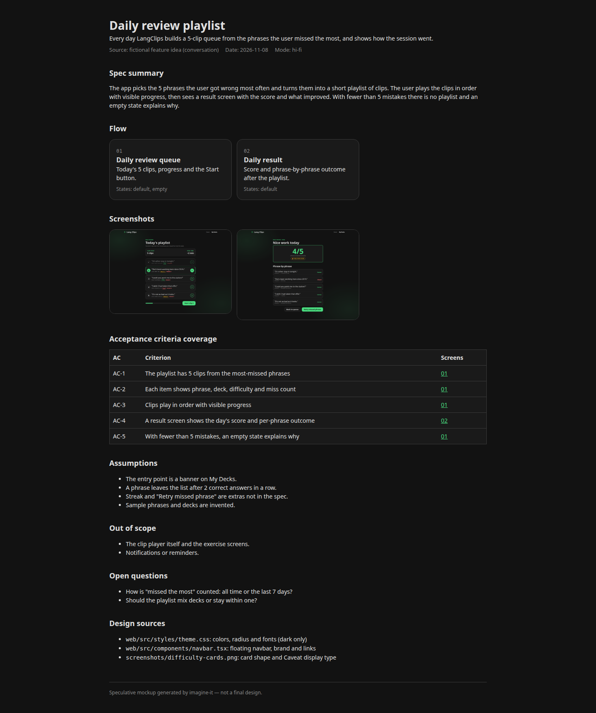
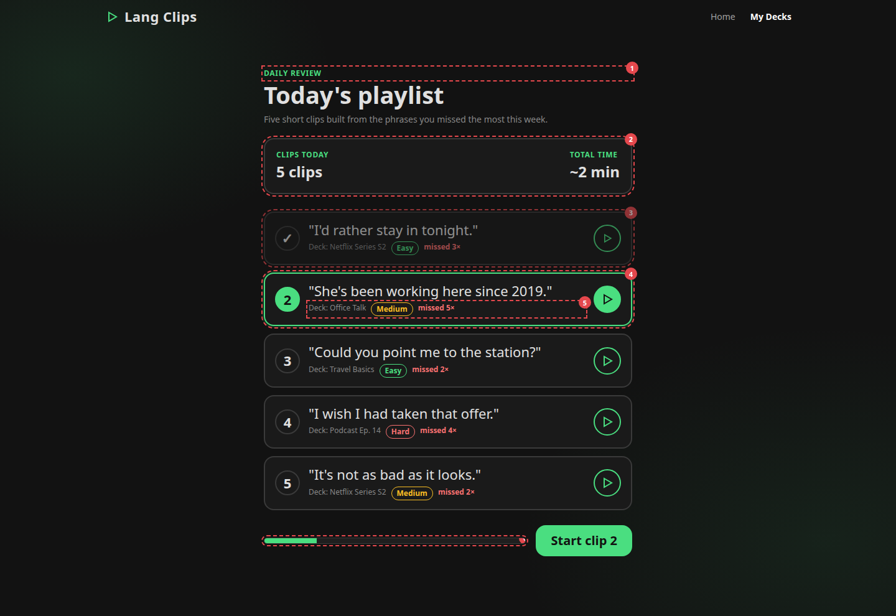

# imagine-it

> Turn a spec into something you can *look at*.

`imagine-it` is an agent skill for **Claude Code** and **Google Antigravity (`agy`)**. Hand it a GitHub issue, a Jira ticket, a PRD, or just the feature you've been discussing, and it reads your repo's design language and writes a small set of plain `.html` files: a speculative mockup of the feature, styled like *your* product.

```
/imagine-it #142
/imagine-it ABC-123 --wireframe
/imagine-it docs/specs/bulk-export.md --screens 3
/imagine-it                       # uses the current conversation as the spec
```

## What you get

Written to `<out>/<slug>/` (default `<out>` = `.imagine-it/`):

```
.imagine-it/142-bulk-export/
├── index.html        hub: spec summary, flow, AC coverage, assumptions, open questions, design sources
├── 01-orders-list.html
├── 02-export-dialog.html
├── 03-export-status.html
├── screenshots/      optional, with --screenshot: PNG/JPEG of each screen and the hub
├── styles.css        your repo's tokens + mockup chrome
└── ii.js             tiny toolbar: next/prev screen, state switcher, spec notes
```

- **Matches your design.** Detects your stack (Tailwind, MUI, shadcn, Chakra, SCSS, Flutter, …), extracts colors, fonts, radius and spacing, copies your app shell and nav labels, and writes copy in your UI language. No UI in the repo? It falls back to a grayscale wireframe.
- **As many screens as the task needs.** One file per view or major overlay; empty, loading, error and success states are switchable inside each screen.
- **Traceable.** Elements carry `data-note="AC-2: …"`. Press `n` (or use the toolbar) to overlay which acceptance criterion each piece satisfies, and which parts are assumptions.
- **Plain and portable.** HTML + CSS + a few lines of vanilla JS. No CDNs, no build step, no network. Double-click `index.html`.

It is a conversation piece, not production code.

## Example output

A full run lives in [`examples/daily-review-playlist/`](examples/daily-review-playlist/index.html): a made-up "daily review playlist" feature for a language-learning app, mocked up in that app's dark theme. Open `index.html` straight from disk. Press `n` to see which acceptance criterion each element covers.

| Hub | Screen with notes overlay (`n`) |
| :--- | :--- |
|  |  |

The feature, phrases and decks are invented for the demo.

## Install

Pick one.

### 1. `npx skills` (Claude Code + Antigravity in one go)

```bash
npx skills add victor-lis-bronzo/imagine-it-skill --skill imagine-it -g -a claude-code -a antigravity-cli -y
```

Drop `-g` to install into the current project instead. Add `-a antigravity` for the Antigravity IDE, or `--copy` to copy files rather than symlink.

### 2. Claude Code plugin

```bash
claude plugin marketplace add victor-lis-bronzo/imagine-it-skill
claude plugin install imagine-it@imagine-it-skill
```

Plugin skills are namespaced: invoke as `/imagine-it:imagine-it`.

### 3. Antigravity plugin

```bash
git clone https://github.com/victor-lis-bronzo/imagine-it-skill
agy plugin install ./imagine-it-skill
```

After `agy plugin install`, ask for it by name or type `/imagine-it` in the `agy` TUI; run `agy plugin list` to see the exact name.

### 4. Install script

```powershell
# Windows (PowerShell)
git clone https://github.com/victor-lis-bronzo/imagine-it-skill; cd imagine-it-skill
./scripts/install.ps1                    # global, Claude + Antigravity
./scripts/install.ps1 -Claude            # Claude only
./scripts/install.ps1 -Agy               # Antigravity only
./scripts/install.ps1 -Project C:\path\to\repo
./scripts/install.ps1 -Link              # symlink: `git pull` updates the skill
./scripts/install.ps1 -Uninstall
```

```bash
# macOS / Linux / Git Bash
./scripts/install.sh                     # global, Claude + Antigravity
./scripts/install.sh --agy
./scripts/install.sh --project ~/code/my-app
./scripts/install.sh --link
./scripts/install.sh --uninstall
```

### Manual

Copy `skills/imagine-it/` to:

| Where | Claude Code | Antigravity |
|---|---|---|
| Global | `~/.claude/skills/imagine-it` | `~/.gemini/config/skills/imagine-it` |
| Project | `.claude/skills/imagine-it` | `.agents/skills/imagine-it` |

Manual, script and `npx skills` installs invoke as plain `/imagine-it`.

## Usage

| Input | Example |
|---|---|
| GitHub issue / PR | `/imagine-it #142`, `/imagine-it https://github.com/org/repo/issues/142` (needs `gh` or a GitHub MCP) |
| Jira ticket | `/imagine-it ABC-123` (needs a Jira MCP, otherwise paste the ticket) |
| Spec file | `/imagine-it docs/prd.md` |
| Free text | `/imagine-it a bulk-export dialog on the orders list` |
| Nothing | `/imagine-it` after discussing a feature |

| Flag | Effect |
|---|---|
| `--wireframe` | Grayscale wireframe, ignores the repo's visual style |
| `--out <dir>` | Output root (default `.imagine-it/`) |
| `--screens <n>` | Cap or force the number of screen files |
| `--screenshot[=png\|jpeg]` | Also capture images of the screens (PNG default, JPEG quality 90) |
| `--states` | With a screenshot, capture every state of each screen, not just the initial one |
| `--viewport <WxH>` | Capture size (default `1440x900`; `390x844` for mobile-first products) |
| `--notes` | Capture with the spec-notes overlay on (default off) |

### Screenshots

```
/imagine-it #142 --screenshot
/imagine-it #142 --screenshot=jpeg --states
```

Full-page images of each screen, plus the hub, are written to `<out>/<slug>/screenshots/` (for example `01-orders-list--empty--dark.png`) and linked from a Screenshots section in `index.html`. If your repo has dark mode, the skill asks whether to capture light, dark or both (recommended: both); single-mode repos are captured as-is. Without a browser tool it falls back to headless Chrome/Edge, which captures the viewport only and writes PNG only (JPEG needs a converter such as `magick`); if nothing works, the HTML is still delivered and the manual command is printed.

Iterate in conversation ("make the dialog a side drawer"): the skill edits the same folder.

Add `.imagine-it/` to your `.gitignore` unless you want the mockups versioned.

## How it works

1. **Spec digest**: goal, flow, entities, states, numbered acceptance criteria; gaps become listed assumptions.
2. **Design brief**: read-only sweep of the repo for tokens, shell, components and the screens closest to the feature.
3. **Screen plan**: the table of files to write, checked so every acceptance criterion is covered.
4. **Generate** the HTML, then **verify** links, offline-ness and AC coverage.

The workflow lives in [`skills/imagine-it/SKILL.md`](skills/imagine-it/SKILL.md); details are in `references/`.

## Releasing

The version lives in both `plugin.json` (repo root, for agy) and `.claude-plugin/plugin.json` (Claude). Bump both.

## License

MIT
